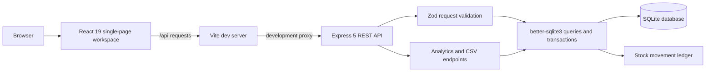

# StockPilot architecture

## Runtime overview

In development, Vite serves the React app and proxies `/api` to the API at `http://localhost:3001`. The API binds to `127.0.0.1` by default. Production does not use Vite as the application server: `npm run build` creates `dist/`, which must be served by a static server or reverse proxy that also routes `/api` to the Express process.

## Frontend responsibilities

- `src/main.jsx` mounts the React app into `#root`.
- `src/App.jsx` delegates to the business workspace.
- `src/BusinessApp.jsx` owns the primary navigation, active page selection, fetch helper, query construction, loading/error/success states, business forms, confirmation dialogs, and analytics CSV download flow.
- `src/styles.css` and `src/business.css` define the application styles and responsive workspace patterns.

The workspace navigation is grouped as:

| Group | Pages |
| --- | --- |
| Overview | Dashboard, Reports |
| Catalog | Products, Categories, Suppliers, Customers |
| Operations | Sales orders, Purchase orders, Goods receipts, Stock movements |
| Finance | Invoices, Payments, Returns & refunds |

The active page drives data loading in `BusinessApp.jsx`. Pages request their records from the matching `/api` routes; create/edit dialogs load options such as products, suppliers, customers, orders, invoices, or payments as needed. Mutations use JSON requests and refresh affected views. The browser CSV helper fetches the export endpoint and downloads the returned file; it does not build report rows itself.

## Backend and request flow

1. `server/index.js` validates the configured port, selects host/port from the environment, calls `createApp()`, and starts Express.
2. `server/app.js` creates the API app and database if one is not injected. It sets basic security headers, applies the configured CORS origin allowlist, and limits JSON request bodies to 100 KB.
3. Route handlers validate request bodies with strict Zod schemas and validate IDs and query parameters in the handlers.
4. Parameterized SQLite queries perform reads and updates. Multi-step business mutations use better-sqlite3 transactions.
5. Stock-changing operations use `ledgerStockMovement` from `server/database.js` so the stock row and corresponding movement write happen together.
6. Successful resource creation generally returns `201` and a named JSON property; reads and updates generally return `200`; successful product/category deletion returns `204`.

The common error handler returns JSON shaped as `{ "error": "..." }`. Invalid JSON is a `400`; route/schema validation errors are also `400`; missing records are `404`; invalid business transitions, duplicate records, and conflicts commonly return `409`; forbidden manual adjustments return `403`. Unexpected server errors return a generic message and are logged server-side.

## Data access and persistence

`server/database.js` is the SQLite access layer. It:

- Opens the configured SQLite file (default `data/stockpilot.db`).
- Enables WAL mode and `PRAGMA foreign_keys = ON`.
- Applies versioned migrations transactionally.
- Runs deterministic sample-data seeding for development file-backed databases, but not in production mode.
- Exposes stock movement and stock reconciliation helpers.

Business queries and route-specific transactions are in `server/app.js`; there is no separate ORM or repository package. See [DATABASE.md](DATABASE.md) for the actual tables and relationships.

## Startup and maintenance flow

### Local development

`npm run dev` starts `dev:api` and `dev:web` together with `concurrently`. The API uses `node --watch server/index.js`; the frontend uses Vite. The Vite proxy in `vite.config.js` forwards `/api` to `http://localhost:3001`.

### Production preparation

Production startup requires an explicit `DATABASE_PATH` to a previously provisioned persistent database. The API refuses an in-memory or missing/empty production database and disables sample seeding. Provision with `npm run db:migrate`, verify with `npm run db:verify`, then start the API with `npm start`.

Operational scripts:

- `server/migrate.js` applies migrations without sample seeding.
- `server/backup.js` uses SQLite's online backup API; it requires `DATABASE_PATH` and a new `BACKUP_PATH`.
- `server/verify-database.js` opens a file read-only and checks SQLite integrity, foreign-key violations, and migration metadata.

## Configuration

The code reads these environment variable names: `NODE_ENV`, `DATABASE_PATH`, `HOST`, `PORT`, `CORS_ORIGINS`, `STOCK_ADJUSTMENT_TOKEN`, and `BACKUP_PATH`. Node does not load `.env` files in this project; values must be supplied by the shell or process manager. See the root README and `.env.example` for documented safe local settings. Never place real secret values in documentation or the example file.

## Security boundary

The API currently has no application-wide authentication or role-based authorization. CORS is an origin policy, not authentication. `STOCK_ADJUSTMENT_TOKEN` only gates manual stock-adjustment requests. Public/shared deployment is blocked until general authentication and authorization are implemented and verified.
