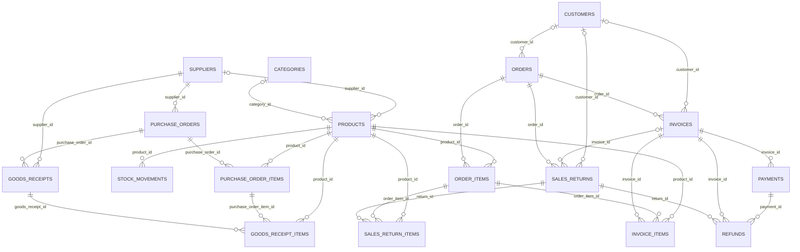

# StockPilot database

## Database engine and startup behavior

StockPilot uses SQLite through `better-sqlite3`. The default development file is `data/stockpilot.db`; `DATABASE_PATH` overrides it. The database layer enables WAL mode and foreign-key enforcement on each connection. Migrations are stored in `schema_migrations` and applied one at a time inside SQLite transactions. The current source defines migration versions 1 through 7.

Development file-backed databases receive deterministic sample catalog data, inserted only where the corresponding category, supplier, customer, or SKU is absent. Production migration/startup does not seed sample records. Existing records are preserved by migrations; the migration runner creates a timestamped file backup before applying pending migrations to an existing older database.

## Migration history

| Version | Name | Purpose |
| --- | --- | --- |
| 1 | `baseline_schema` | Creates products, sales orders, order lines, and baseline indexes. |
| 2 | `business_foundation` | Adds categories, suppliers, customers, product metadata, customer linkage, and safe indexes. Existing product category text remains available. |
| 3 | `stock_ledger` | Adds stock movement history and supporting indexes. |
| 4 | `business_data_integrity` | Adds case-insensitive uniqueness triggers and initializes ledger history for existing positive stock where no movement exists. |
| 5 | `purchasing_and_sales_lifecycle` | Adds purchasing/receipt tables and sales lifecycle fields; marks existing sales data as previously confirmed/deducted. |
| 6 | `invoices_payments_returns_and_refunds` | Adds invoice, payment, return, and refund tables plus constraints, indexes, and transition/immutability triggers. |
| 7 | `analytics_date_range_indexes` | Adds date-oriented indexes for analytics and history queries. |

Migration definitions and the migration runner are in `server/database.js`; command-line provisioning is in `server/migrate.js`.

## Tables and key fields

All business tables use an integer autoincrement `id` primary key unless noted. `schema_migrations.version` is its primary key. SQLite's `INTEGER PRIMARY KEY AUTOINCREMENT` is used in the definitions. Important fields are listed here; timestamps and other operational metadata are omitted from the summaries.

| Table | Main fields and role |
| --- | --- |
| `products` | `sku` (case-insensitive unique), `name`, legacy `category` text, `price` and `quantity` in cents/units, `low_stock_threshold`, description, optional category/supplier links, unit cost, maximum stock, unit of measure, active/archive metadata. |
| `categories` | Name, description, created/updated timestamps. Name uniqueness is guarded case-insensitively by triggers. |
| `suppliers` | Supplier code, business/contact information, notes, active flag, timestamps. Supplier-code uniqueness is guarded case-insensitively. |
| `customers` | Customer code, name/contact information, notes, active flag, timestamps. Customer-code uniqueness is guarded case-insensitively. |
| `orders` | Order number, customer name, total, optional customer ID, status, payment-status field, notes, created/updated timestamps, and stock-deduction timestamp. |
| `order_items` | Order/product links and product name, SKU, quantity, unit-price snapshots. |
| `stock_movements` | Product ID, movement type, nonzero quantity delta, previous/new quantities, optional reference type/ID, reason, notes, timestamp. |
| `purchase_orders` | Order number, supplier, status, subtotal/tax/total, notes, timestamps, submitted/cancelled timestamps. |
| `purchase_order_items` | Purchase order/product, name/SKU snapshots, ordered/received quantities, unit cost, discount, tax basis points, line totals. |
| `goods_receipts` | Unique receipt number, purchase order, supplier, received timestamp, notes, creation timestamp. |
| `goods_receipt_items` | Receipt, purchase-order line, product, received quantity, unit cost. |
| `invoices` | Unique invoice number, order and optional customer, customer/order snapshots, invoice/due dates, status, subtotal/discount/tax/total. |
| `invoice_items` | Invoice/order-line/product links and product/SKU/quantity/price/financial snapshots. A line is unique per invoice/order line. |
| `payments` | Invoice, unique payment reference, optional unique external reference, positive amount, USD currency, method, status, payment date, notes. |
| `sales_returns` | Unique return number, order, optional invoice/customer, customer snapshot, return date/reason/status/completion metadata. |
| `sales_return_items` | Return/order-line/product links, item snapshot, quantity, restockability/reason, unit price, eligible refund amount. |
| `refunds` | Unique refund reference, return/invoice/payment links, positive amount, USD currency, method, optional unique external reference, status and timestamps. |
| `schema_migrations` | Applied version, unique migration name, applied timestamp. |

## Verified foreign-key relationships

The following links are explicitly declared with SQLite `REFERENCES` clauses in the migration source. Matching column names without a declared `REFERENCES` clause are not treated as foreign keys.

The diagram describes declared foreign keys, not every business-level association. In particular, stock movement `reference_type` and `reference_id` are polymorphic reference metadata, not foreign keys.

## Inventory ledger and reconciliation

`products.quantity` stores current stock. Stock changes in supported transactional workflows call `ledgerStockMovement()` in `server/database.js`. That helper reads the current quantity, computes and validates the result, updates the product using a quantity compare condition, and inserts a movement containing before/after quantities. When called outside an existing transaction it wraps the operation in an immediate SQLite transaction; callers performing larger workflows include it in their own transaction.

Movement types constrained by the schema are `initial_stock`, `sale`, `purchase`, `adjustment`, `return_in`, `return_out`, and `write_off`. A movement must have a nonzero delta and nonnegative before/after quantities. Negative resulting stock is rejected. The reconciliation helper compares the product's current quantity to the `new_quantity` of its latest ledger movement; it reports mismatches and does not silently repair them.

## Money and snapshots

Money values are stored as integer cents in SQLite and mapped to numeric dollar values by API mappers. Purchase order line tax rates are stored in basis points. Current product price/cost may change, so sales order lines and invoices store item snapshots to preserve historical names, SKUs, quantities, and prices.

Invoices are created from eligible sales orders and snapshot customer and line details. Invoice item rows and issued invoice commercial fields are protected from edits by triggers. Payment amount and transaction details are immutable; payment status transitions are constrained. Return lines snapshot the sold-line details and eligible credit. Return quantities are reserved against quantities already drafted or accepted; accepted restockable lines create a stock-ledger movement, while non-restockable lines do not. Refunds link to an accepted return, invoice, and completed payment and are capped by eligible return credit and unrefunded payment amount.

## Integrity and deletion behavior

- Foreign keys are enabled by the database connection and can be checked using `npm run db:verify`.
- Database `CHECK` constraints enforce positive quantities/amounts and valid status/boolean enumerations where declared.
- Unique constraints and triggers protect SKUs, category names, supplier/customer codes, references, and receipt/invoice/return identifiers.
- Historical product, purchase receipt, invoice, payment, return, and refund relationships use restrictive foreign keys or immutable-record triggers where defined.
- Deleting a category with associated products is rejected by the API. Suppliers/customers are deactivated to preserve business history.

For a non-destructive integrity check of an existing database, set `DATABASE_PATH` to the intended file and run `npm run db:verify`. Do not use migration, seed, or reset commands against an existing database unless that operation is intentionally planned and backed up.
